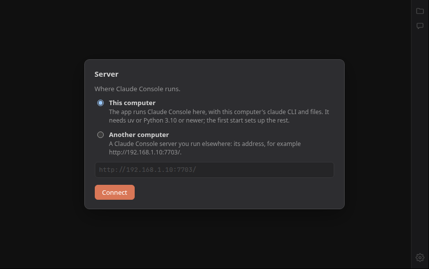

# Claude Console desktop

[English](README.md) | 简体中文

[Claude Console](https://github.com/BoZhen/claude-console) 的桌面窗口，内置
[web file manager](https://github.com/BoZhen/web-file-manager)：不必再为控制台开一个浏览器标签页、
再为对话里链接到的每个文件各开一个。基于 Electron 44，支持 Linux（KDE、X11）和 macOS。

控制台可以运行在另一台电脑上（app 连接到那台服务器），也可以运行在这台电脑上：
此时 app 用这台电脑的 `claude` CLI 自己启动 Claude Console 和文件管理器，退出时把它们停掉
（见[这台电脑](#这台电脑)）。app 可以同时容纳多台电脑，每台有自己的控制台：显示其中一台，
其余的在后台继续运行，用窗口右边缘的按钮切换（见[多台电脑](#多台电脑)）。

<p align="center">
  
</p>
<p align="center">
  <sub>窗口里显示的就是 Claude Console：计划固定在一条带 KaTeX 公式和文件链接的回答上方，
  右边是关于选中公式的 side chat。在 app 里，对话中的文件路径会在侧边面板里打开那个文件，
  与文件管理器 <b>Files</b> 并列。更多截图见
  <a href="https://github.com/BoZhen/claude-console/blob/main/README.zh-CN.md">Claude Console 的 README</a>。</sub>
</p>

## 下载与安装

[最新 release](https://github.com/BoZhen/claude-console-desktop/releases/latest)
里有 macOS 和 Linux 的安装包，以及记录它们校验和的 `SHA256SUMS`。

**macOS**（Apple 芯片）：下载 `Claude-Console-mac-arm64.dmg` 并打开。在弹出的窗口里把
Claude Console 拖到 Applications 上，然后推出磁盘，从“应用程序”里启动 Claude Console。
app 没有经过 Apple 公证，所以第一次启动需要确认一次，见 [macOS](#macos)。

**Linux：Ubuntu、Debian、KDE neon、Linux Mint 等**（x86-64）：下载
`claude-console_<版本>_amd64.deb`，然后在终端里、在它所在的文件夹中运行：

```bash
sudo apt install ./claude-console_1.2.0_amd64.deb
```

app 装在 `/opt/claude-console`，并带有菜单项和图标；从菜单启动 Claude Console。新版本的
`.deb` 用同样的方式覆盖安装。`sudo apt remove claude-console` 卸载，`~/.config/Claude Console`
里的设置保留。apt 还会装上 `python3-venv`：没有装 uv 时，[这台电脑](#这台电脑)模式需要它。

**Linux：其他发行版**（x86-64）：下载 `Claude-Console-linux-x64.tar.gz`，然后在终端里、
在它所在的文件夹中运行：

```bash
tar xzf Claude-Console-linux-x64.tar.gz
claude-console-linux-x64/install.sh
```

`install.sh` 把 app 复制到 `~/.local/opt/claude-console`，并把 Claude Console 连同图标加入
应用菜单。在限制用户命名空间的系统上（Ubuntu 23.10 及以后），它还会安装一个 AppArmor
profile，所以 sudo 会问一次密码（原因见 [Linux 在这台电脑上从源码运行](#linux-在这台电脑上从源码运行)）。
之后从菜单启动 Claude Console，解压出的文件夹就不再需要了。新版本的安装包用同样的方式安装，
设置保留；`claude-console-linux-x64/install.sh --remove` 卸载 app，`~/.config/Claude Console`
里的设置保留。

校验下载的文件：在文件所在的文件夹中，macOS 上运行 `shasum -a 256 -c SHA256SUMS`，Linux 上运行
`sha256sum -c SHA256SUMS`（没有下载的文件会报告为缺失）。

第一次启动时，app 会问[控制台运行在哪里](#控制台运行在哪里)。这些安装包不带更新密钥，
所以不会自动更新：新版本以新的 release 发布。Intel Mac 的版本可以在源码目录里用
`ARCHS=x64 scripts/build-mac.sh` 构建。

## 界面与行为

- **对话中的文件路径**（以及 📂 Open folder 和图片缩略图）在右边的**侧边面板**里打开，
  每个文件一个标签页。再次点击同一个路径会切到那个标签页并重新加载，因为 Claude 可能改过
  这个文件。键盘焦点留在控制台里。
- 侧边面板的第一个标签页 **Files** 就是文件管理器本身，不能关闭。
- **右侧按钮列**（窗口右边缘的一列按钮）：文件夹按钮打开侧边面板；对话气泡按钮在控制台的
  抽屉里打开 **Side chats**；它下面的机器人按钮打开抽屉的 **Agents** 标签页，即当前显示的
  session 的子代理，按钮上的数字是其中仍在运行的个数（没有 Agents 标签页的旧版控制台不显示这个
  按钮）；底部的齿轮打开控制台的 **Settings**（Appearance、Accounts、About）。再按一次就关闭，
  抽屉当前显示的标签页对应的按钮会高亮。只有一台电脑时，侧边面板打开后按钮列隐藏，面板的标签栏里
  有同样的 Side chats、Agents 和 Settings 按钮；有[多台电脑](#多台电脑)时，按钮列留在面板旁边。有文件标签页打开时，标签栏里
  还有 **Close all**（Files 保留）。
- **指向其他网站的链接**在系统浏览器中打开。
- **下载**（导出 session、文件管理器的下载按钮）直接存到“下载”文件夹，不会覆盖已有文件
  （改名为 `name (1).ext`）；窗口底部的提示可以在文件夹中显示这个文件。
- **HTTP 登录**（文件管理器的 Basic Auth）：弹出登录对话框。勾选 “Remember on this computer”
  会用系统密钥环加密保存登录信息（KDE 上是 KWallet，macOS 上是钥匙串）。没有可用的密钥环时，
  这个勾选框不可用，登录信息只保持到 app 退出。
- 控制台和文件管理器在内网中常用普通 `http`。app 把这两个 origin 当作安全来源
  （Chromium 开关 `unsafely-treat-insecure-origin-as-secure`），因此控制台的 🎙 语音输入和
  剪贴板按钮可以用，而在浏览器标签页里访问普通 `http` 地址时它们不可用。这个开关在启动时设置，
  所以第一次输入的地址要从下次启动起才生效。
- 侧边面板的标签栏和边框采用控制台顶栏的颜色，并随它的主题设置变化。
- 控制台无法访问时，会显示一个带错误信息的页面，每 5 秒重试一次，页面上有
  **Edit computer…** 按钮。

窗口大小、侧边面板的宽度，以及每台电脑的侧边面板是否打开和其中的标签页，都会在下次启动时恢复；
恢复的标签页在第一次显示时才加载。

## 快捷键

| 按键 | 作用 |
|---|---|
| Ctrl+1 … Ctrl+9（⌘1 … ⌘9） | 显示右侧按钮列上的第 1 … 9 台电脑（仅在有多台电脑时） |
| Ctrl+\\（⌘\\） | 显示 / 隐藏侧边面板 |
| Ctrl+F（⌘F） | 在控制台或侧边面板的标签页中查找，取最后点击过的那一个；Enter / Shift+Enter：下一个 / 上一个；Esc 关闭 |
| Ctrl+W（⌘W） | 关闭侧边面板的标签页（从不关闭窗口） |
| Ctrl+Tab、Ctrl+Shift+Tab | 下一个 / 上一个侧边面板标签页 |
| Ctrl+R、F5（⌘R） | 重新加载控制台或侧边面板的标签页；加 Shift 时不使用缓存 |
| Ctrl+= / Ctrl+- / Ctrl+0 | 缩放该页面 |
| Alt+← / Alt+→（⌘[ ⌘]）、鼠标后退 / 前进键 | 该页面的历史记录 |
| F12、Ctrl+Shift+I | 该页面的开发者工具 |

app 从不占用 Esc：在控制台里，Esc 用来中断正在进行的回合。
鼠标中键点击关闭侧边面板的标签页；右键点击标签页：重新加载、在浏览器中打开、复制地址、关闭、
关闭其他、关闭所有文件标签页。在页面中右键：在侧边面板或浏览器中打开链接、复制、粘贴、
保存图片、检查元素。

## 控制台运行在哪里

第一次启动时 app 会问：**This computer**（这台电脑）还是 **Another computer**（另一台电脑，
填写地址）。

<p align="center">
  
</p>

之后可以在控制台的 **Settings → About → Server → Change…**、菜单 **File → Edit computer…**
（Linux 上按 Alt 显示菜单栏），或者“无法访问”和“没有启动”页面上的按钮里更改。

另一台电脑：构建时可以在 `config.json` 里写入地址（见下文），app 按顺序尝试，直到有一个响应：
例如先通过 VPN 访问控制台，再通过另一个网络访问同一个控制台，这样笔记本电脑在任一网络下都能
直接连上。这样的构建启动时直接使用这些地址，不再询问；`config.json` 也可以列出多台电脑。
从另一个地址恢复的标签页会移到当前使用的地址。在对话框里把地址留空，就回到按顺序尝试
`config.json` 里的地址。`--url=http://host:port/`（或 `CLAUDE_CONSOLE_URL`）在这一次运行中只显示
这个地址，不改动已保存的电脑列表；`--local`（或 `CLAUDE_CONSOLE_LOCAL=1`）只显示这台电脑；
`CLAUDE_CONSOLE_URLS`（逗号分隔）替换 `config.json` 里的地址。文件管理器的地址由控制台提供
（`CLAUDE_CONSOLE_WEBFM_URL`，否则是控制台所在主机的 7701 端口）。

设置和保存的登录信息：`~/.config/Claude Console/`（`settings.json`、`logins.json`）；
macOS 上是 `~/Library/Application Support/Claude Console/`。

## 多台电脑

点击右侧按钮列顶部带加号的电脑图标（只有一台电脑时，按钮列在侧边面板关闭时显示），
或者菜单 **File → Add computer…**，添加另一台电脑：为它的按钮起个名字，再选这台电脑或者填写地址。
每台电脑有自己的 Claude Console 页面和自己的侧边面板标签页。正在显示的那台占满窗口，
其余的在后台继续运行，它们的 session 继续进行，连接保持。

- **右侧按钮列**在有两台或更多电脑时为每台电脑显示一个按钮（名字的首字母），并且侧边面板
  打开时也保留在面板旁边。点击按钮或按 Ctrl+1 … Ctrl+9（⌘1 … ⌘9）切换；窗口标题会写出
  正在显示的电脑。
- 按钮上**带数字的红点**：那台电脑上有等待处理的审批或提问。**灰点**：那台电脑不在显示时，
  有一个回合结束了。它们来自控制台的 `api/notify/stream`，即手机 app 的通知所用的数据流；
  没有这个接口的控制台不显示圆点。
- **右键点击按钮**可以编辑这台电脑（名字、运行在哪里）、重新加载它的控制台，或者移除它。
  移除前会先确认，并且只是把它从 app 中去掉：它的控制台在那台电脑上继续运行。最后一台电脑不能移除。
- **这台电脑**可以是其中之一，但只能有一个。它的控制台和文件管理器在 app 运行期间一直运行，
  无论是否在显示。
- 控制台中的文件路径在那台电脑自己的侧边面板中打开，内容来自那台电脑的文件管理器。
- 电脑列表、正在显示的电脑，以及每台电脑的侧边面板标签页都保存在 `settings.json` 里。
  只支持一个服务器的旧版本的设置会变成只含那一台电脑的列表。
- 以普通 http 地址添加的电脑，要在 app 重启后才能使用麦克风和剪贴板按钮：Chromium 只在 app
  启动时把这类地址当作安全来源。

## 这台电脑

适用于运行 app 的这台电脑上装有 `claude` CLI 的情况。app 自带 Claude Console 和
web file manager 的代码（`scripts/stage-server.sh` 从与本仓库并列检出的
[claude-console](https://github.com/BoZhen/claude-console) 和
[web-file-manager](https://github.com/BoZhen/web-file-manager)，或者从 `CLAUDE_CONSOLE_DIR` 和
`WEBFM_DIR` 复制到安装包里），并在 127.0.0.1 上运行它们：

- **需要的东西**：在终端里登录过一次的 `claude` CLI，以及 [uv](https://docs.astral.sh/uv/) 或者
  Python 3.10 及以上。第一次启动时会在 `<设置文件夹>/server/venv` 中创建一个 Python 环境，装入
  tornado、Claude Agent SDK 和 2 以下版本的 `mcp`（`server-requirements.txt`）。用 uv 大约需要 20 秒；
  如果这台电脑没有足够新的 Python，uv 会自己下载一个。之后的启动只需一两秒。依赖改变时，或者环境
  不再可用时（例如它的 Python 被删除了），会重新创建环境。
- **它的环境变量**与终端里的相同：app 从登录 shell 读取（`$SHELL -ilc env`），因为从 Dock 或菜单
  启动的程序拿到的 PATH 不含 Homebrew 和 `~/.local/bin`。
- **端口**：17703（控制台）和 17701（文件管理器），这样你自己在 7703 上运行的控制台不受影响。
  在 `settings.json` 中写 `"localPorts": {"console": …, "fm": …}` 可以改端口。
- **文件管理器**在第一次启动时生成一个登录信息（`<设置文件夹>/server/webfm-login`，只有所有者可读）；
  app 自己完成登录。
- **退出 app 会停止这两个服务器**，以及其中仍在运行的 Claude session。上次运行被强行结束时留下的
  服务器，会在下次启动时停止。
- **没有启动成功时**，页面会说明原因（没有 `claude` CLI、没有 uv 或 Python、端口被占用），并提供
  **Try again**。服务器的输出在 `<设置文件夹>/server/logs/console.log` 和 `webfm.log` 里，上一次运行的在
  `.log.1` 里。
- 控制台的状态保存在 `~/.claude` 里，与你自己启动的控制台相同；同一个账户下一次只运行其中一个。

## 更新

安装好的 app（下面的安装包）从控制台更新自己的代码；其中的 Electron 运行时不变。在这台电脑上：

```bash
scripts/publish.sh ["改动说明"]   # 把代码作为更新放到控制台上
```

它把 app 的代码（`main.js`、`computers.js`、`updater.js`、`bundle-pick.js`、`localserver.js`、两个 preload、
`shell/`、图标；完整列表见 `scripts/stage.sh`）打包成一个 asar 归档，其中的 `bundle.json` 写明版本号，
即日期和分钟（`2026.10.23.0612`），用 Ed25519 密钥签名，放到 `~/.local/share/claude-console/desktop`。
控制台在 `api/desktop/latest`（版本、大小、SHA-256、签名、所需的 Electron）和
`api/desktop/bundle/<版本>` 提供它。在[这台电脑](#这台电脑)上运行控制台的 app 会问这台电脑上的控制台，
而它提供的是在同一台电脑上发布的内容，通常没有：这样的安装通过安装新的安装包来更新。
有[多台电脑](#多台电脑)时，app 问正在显示的那一台。

app 在启动 15 秒后检查一次，之后每 6 小时检查一次，也可以在控制台的
**Settings → About → Check for updates** 里手动检查。新版本下载到 `<设置文件夹>/updates`，只有大小、
SHA-256 和签名都核对无误才保留。之后右侧按钮列的齿轮上方（以及侧边面板的标签栏里）会出现一个
带绿色箭头的圆形按钮；点击它会重启 app 进入新版本，About 里的 **Restart to update** 也一样。
app 的入口 `loader.js` 每次启动时运行最新的这类更新，没有时运行内置代码。

- **密钥**：`scripts/make-update-key.sh` 生成一次，存在
  `~/.config/claude-console-desktop/update-signing-key.pem`（只有所有者可读），并把公钥部分写入
  `config.json` 的 `updateKey`，由此进入从这个源码目录构建的每个安装包。安装好的 app 从自己的安装包
  读取公钥，从不从更新中读取，并拒绝用其他密钥签名的更新包，所以一个更新包的可信程度与这台电脑
  相同。请备份这个密钥：没有它，已安装的 app 都不会接受更新，每台都要手动安装下一个安装包。
  没有 `updateKey` 的构建（例如 `--public` 构建）不接受更新，About 里会说明。
- **有问题的更新**不会让 app 无法使用。加载时抛出错误的版本会立即被搁置，app 用内置代码重启；
  启动后始终没有打开窗口的版本，在下次启动时被搁置。被搁置的版本不会再次下载。
- **新的 Electron**（`package.json` 中新的 `electron` 版本）只随新的安装包提供：About 里会说明，
  代码更新等到那时。
- **从源码目录运行时**（`npm start`，或 `scripts/install-linux.sh` 生成的菜单项），app 运行源码目录里的
  代码，从不更新。

测试：`npm test`（运行哪个更新、是否可信）；`test/e2e_update.py <解压后的安装包>` 在 Xvfb 下用一个替身
控制台运行打包好的 app 并更新一次，还会测试伪造的和有问题的更新包（需要装有 tornado 的 Python，
即控制台测试所用的环境）。

## Linux 安装到另一台电脑

```bash
scripts/build-linux.sh            # 同一个 app 的两种安装包，x86-64：
                                  #   dist/claude-console_<版本>_amd64.deb
                                  #   dist/Claude-Console-linux-x64.tar.gz
```

在另一台电脑的终端里，二选一：

```bash
sudo apt install ./claude-console_1.2.0_amd64.deb   # Ubuntu、Debian 等
                                                    # （sudo apt remove claude-console 卸载）
tar xzf Claude-Console-linux-x64.tar.gz             # 任何发行版
claude-console-linux-x64/install.sh                 # （./install.sh --remove 卸载）
```

`.deb`（`scripts/linux-deb.sh`）把 app 装到 `/opt/claude-console`，在 `/usr/bin` 放一个链接，并加上
菜单项和图标。它的 `chrome-sandbox` 带 setuid root 权限，与 Chrome 和 VS Code 的安装包相同：在限制
用户命名空间的系统上，Chromium 的沙箱通过它运行。它依赖 app 链接的那些库，用的是 Debian 12 和
Ubuntu 22.04 的包名（Ubuntu 24.04 改名后的 `t64` 包也提供这些名字），并推荐安装 `python3-venv`、
`libsecret-1-0` 和 `libnotify4`。

tar.gz 把 app 装到 `~/.local/opt/claude-console`，加上菜单项和图标，在 Ubuntu 23.10 及以后还会为
`~/.local/opt/claude-console/claude-console` 安装一个 AppArmor profile（sudo 会问密码，原因见下一节）。
两种安装包再次安装新版本时，都会替换 app 并保留设置。选择 **Another computer** 时，这台电脑必须能
访问那个控制台（同一个网络，或者 VPN）。用更新密钥构建的安装包随后会从控制台自动更新（见[更新](#更新)）。

## Linux 在这台电脑上从源码运行

```bash
npm install                       # Electron 和打包工具（需要镜像源的话，写在你的 .npmrc 里）
npm run fetch-electron            # Electron 程序本身（新版 Electron 会在第一次使用时下载）
scripts/install-linux.sh          # 菜单项 “Claude Console”、图标、AppArmor profile（sudo 一次）
```

`scripts/install-linux.sh` 写入 `~/.local/share/applications/claude-console.desktop` 和
`~/.local/share/icons/hicolor/` 下的图标。在 Ubuntu 23.10 及以后，它还会安装
`/etc/apparmor.d/claude-console-desktop`：一个为 `node_modules/electron/dist/electron` 设置的、带 `userns`
的 unconfined profile，与 Ubuntu 为 VS Code 提供的同类。Ubuntu 只允许有这类 profile 的程序创建用户
命名空间，而 Chromium 的沙箱需要它；没有这个 profile，Electron 在启动时就会停止（“The SUID sandbox
helper binary was found, but is not configured correctly”）。`--no-sudo` 跳过 profile；`--remove` 删除全部内容。

`npm start` 从终端运行 app。

## macOS

```bash
scripts/mac-tools.sh              # 只需一次：构建磁盘镜像用的工具，见下文
scripts/build-mac.sh              # dist/Claude-Console-mac-arm64.dmg（Apple 芯片）
```

这会在 Linux 上用 `@electron/packager` 构建 app（macOS 版 Electron 从 `ELECTRON_MIRROR` 或
`config.json` 的 `electronMirror` 下载，否则从 Electron 的默认地址下载），只构建 Apple 芯片版本
（`ARCHS="arm64 x64"` 同时构建 Intel 版本），做 ad hoc 签名，然后放进磁盘镜像。

在 Mac 上打开 `.dmg`。窗口里有 Claude Console、一个箭头和 Applications 文件夹：把 app 拖到
Applications 上（如果已有旧版本，选择 **Replace**），推出磁盘，然后从“应用程序”里打开 Claude Console。

下载的 app 第一次启动时需要确认一次，因为它只有 ad hoc 签名，没有经过 Apple 公证。macOS 会提示
无法验证这个 app：点击 **完成**（Done；不要点“移到废纸篓”）。然后在 **系统设置 → 隐私与安全性**
中点击 **仍要打开**（Open Anyway），并在随后的对话框中确认。点击“仍要打开”之前先关掉第一个提示，否则确认对话框会被
挡在它后面。之后的启动和 app 自己的更新都不再需要确认。磁盘镜像窗口的背景上用中英文写着同样的步骤。

Mac 必须能访问控制台。之后的更新与 Linux 上一样来自控制台；更新存放在
`~/Library/Application Support/Claude Console/updates`，在 app 之外，所以安装好的 app 及其签名从不被改动。

### 磁盘镜像

`scripts/mac-dmg.js` 在 Linux 上生成它，Linux 上没有 Apple 的 `hdiutil` 和 `codesign`（在 Mac 上则使用
这两个工具）：

1. `rcodesign` 给 app 做 ad hoc 签名。
2. `xorriso` 把 app、指向 `/Applications` 的链接、背景图和一个占位的 Finder 布局写进一个 HFS+ 卷；
   只保留这个卷。
3. `hfs-layout-meta.c`（构建时针对 libdmg-hfsplus 编译）清除 xorriso 给每个文件设置的 Finder 类型和
   创建者。Mac 会把它们显示为 `com.apple.FinderInfo`，`codesign --verify --strict` 随即拒绝这个 app。
   它还读取背景文件的目录 ID 和日期。
4. `make-mac-layout.py` 根据这些信息写入真正的 `.DS_Store`：图标视图、窗口大小、图标位置，以及作为
   Finder 替身的背景图；替身必须写明这个卷自己的 ID 才能显示。
5. 卷获得一个随机的卷 ID，并在根目录打开。libdmg-hfsplus 的 `dmg` 把它压缩成 UDIF 镜像，只有每一步都
   成功时才替换之前的镜像。

构建过程中没有任何一步清除隔离属性或改动 Gatekeeper。

`scripts/mac-tools.sh` 把这些工具下载并构建到 `~/.cache/claude-console-desktop/mac-tools`
（`MAC_TOOLS` 可以改位置）：
- rcodesign 0.29.0，核对其 SHA-256；
- libdmg-hfsplus 的一个固定提交；
- Python 包 `ds-store` 和 `mac-alias`。

需要 git、cmake、带 zlib、bzip2 和 OpenSSL 头文件的 C 编译器，以及带 pip 的 Python（`DMG_PYTHON`，
否则 `python3`）。`xorriso` 用 apt 安装。`RCODESIGN`、`XORRISO`、`HFSPLUS_TOOL`、`DMG_TOOL` 和
`HFSPLUS_SOURCE` 可以指定其他位置的工具。

窗口的外观：
- `scripts/mac-dmg-background.html` 由 `scripts/make-mac-background.sh` 用 headless Chrome 渲染成
  `assets/mac-dmg-background.png`（760 × 560）。如果某一行文字比窗口宽，它会停止。
- 不带参数运行 `scripts/make-mac-layout.py` 会重写 `assets/mac-dmg.DS_Store`，即在卷中为布局预留空间的模板。

修改页面或布局之后运行它们，再重新构建。

检查：
- `npm test` 在构造的卷上测试镜像逻辑。
- `node test/mac-dmg-roundtrip.js` 解开构建好的镜像，与签名后的 app 比较：每个文件、权限和符号链接，
  布局与卷目录的对应，卷头，以及签名哈希。

在 Mac 上，以挂载后的镜像上的 `hdiutil verify` 和 `codesign --verify --deep --strict` 为准，并实际看一眼窗口。

## 本地设置：`config.json` 与自己的图标

你自己的设置不放进仓库。它们写在源码目录顶层的 `config.json` 里，git 会忽略这个文件
（模板是 `config.example.json`）：

```json
{
  "urls": ["http://192.168.1.10:7703/", "https://console.example.ts.net:7703/"],
  "updateKey": "-----BEGIN PUBLIC KEY-----\n…\n-----END PUBLIC KEY-----",
  "electronMirror": "https://npmmirror.com/mirrors/electron/"
}
```

- `urls`：一台电脑的控制台地址，在对话框里没有选定地址时按顺序尝试，直到有一个响应。
  多台电脑用 `computers`：

  ```json
  "computers": [
    { "name": "Office", "urls": ["http://192.168.1.10:7703/", "https://office.example.ts.net:7703/"] },
    { "name": "Lab", "urls": ["http://192.168.1.20:7703/"] }
  ]
  ```

  它们在 app 第一次启动时加入电脑列表；之后再加进 `config.json` 的电脑在下次启动时加入，
  在 app 里移除的电脑不会再被加回来。
- `updateKey`：更新必须用来签名的公钥；由 `scripts/make-update-key.sh` 写入（见[更新](#更新)）。
- `electronMirror`：没有设置 `ELECTRON_MIRROR` 时，构建脚本从哪里下载 Electron。

npm 自己的设置（例如镜像源）写在 `.npmrc` 里，git 同样忽略它。从源码目录运行时直接读取
`config.json`；`scripts/stage.sh` 把它复制进从这个源码目录构建的每个安装包和更新。没有这个文件的构建
没有任何地址，第一次启动时询问控制台运行在哪里，默认选中这台电脑。

自己的图标：放在 `assets/local/` 里的 `icon.png`（1024 px）和 `icon.icns`（git 同样忽略）会替换仓库里的
图标，用于从这个源码目录构建的安装包和更新、`scripts/install-linux.sh` 生成的菜单项，以及从源码目录
运行时的窗口。

要把安装包给别人，用 `--public` 构建：`scripts/build-mac.sh --public` 或 `scripts/build-linux.sh --public`
不论源码目录里有什么，都不带 `config.json` 和你自己的图标，输出到 `dist/public/`。这样的安装包没有
服务器地址，也没有更新密钥。

## 文件

| 文件 | 内容 |
|---|---|
| `config.json` | 你的电脑地址；本地文件，git 忽略（模板：`config.example.json`） |
| `loader.js` | 入口：运行最新的可信更新，否则运行内置代码 |
| `bundle-pick.js` | 运行哪个更新，以及它是否可信（公钥） |
| `updater.js` | 检查控制台、下载并核对更新、重启进入新版本 |
| `localserver.js` | “这台电脑”：Python 环境，启动和停止控制台与文件管理器 |
| `server-requirements.txt` | 它们需要的 Python 包；`scripts/stage-server.sh` 把它们的代码复制进安装包 |
| `computers.js` | 电脑列表：来自 `settings.json`、`config.json` 和命令行，迁移只支持一个服务器的旧设置，名字和首字母 |
| `main.js` | 窗口、链接去向、登录、下载、权限、右键菜单、快捷键、菜单，以及未显示电脑的通知流 |
| `shell/index.html`、`shell.css`、`shell.js` | 窗口自己的页面：每台电脑一个控制台 `<webview>`、右侧按钮列及其中的电脑、带标签页的侧边面板、分隔条、查找栏、对话框 |
| `preload-shell.js` | 窗口页面可以调用的 `main.js` 接口 |
| `preload-guest.js` | 运行在控制台和文件管理器页面中：上报顶栏颜色、鼠标后退 / 前进；为 Settings → About 提供 `window.ClaudeConsoleDesktop` |
| `assets/icon.png`、`icon.icns` | app 图标：用黏土质感的方块拼成的像素 C 和光标，由 `scripts/make-icons.py` 三维渲染（numpy、Pillow） |
| `assets/local/` | 你自己构建时用的图标；本地文件，git 忽略 |
| `scripts/install-linux.sh`、`build-mac.sh`、`mac-Info.plist` | 安装与打包 |
| `scripts/mac-dmg.js`、`hfs-layout-meta.c`、`make-mac-layout.py`、`mac-tools.sh` | macOS 磁盘镜像 |
| `scripts/mac-dmg-background.html`、`make-mac-background.sh`；`assets/mac-dmg-*` | 磁盘镜像窗口：背景页面和图片、布局模板 |
| `scripts/build-linux.sh`、`linux-deb.sh`、`linux-install.sh` | Linux 安装包：`.deb`，以及带 `install.sh` 的 tar.gz |
| `scripts/stage.sh`、`publish.sh`、`make-update-key.sh` | 把 app 的代码作为签名的更新放到控制台上 |
| `test/` | `npm test`（含 `computers.test.js`）；`e2e_update.py`、`e2e_config.py`、`e2e_computers.py`（多台电脑，用替身控制台）、`e2e_agents.py`（Agents 按钮，用旁边那份 claude-console 的真实页面）、`e2e_local.py`（这台电脑，用真实的服务器）；`mac-dmg-roundtrip.js`（配合 `mac-layout-check.py`、`mac-signatures.py`）；`readme_shots.py`（`figs/first-start.png`） |

`CCD_DEBUG=1` 打印 `main.js` 处理的按键和它打开的右键菜单。

## 许可证

MIT，见 [LICENSE](LICENSE)。安装包中还带有 Electron，以及 Claude Console 和 web file manager 的代码及
它们使用的库，各自遵循自己的许可证：见 [THIRD-PARTY-NOTICES.md](THIRD-PARTY-NOTICES.md)。
